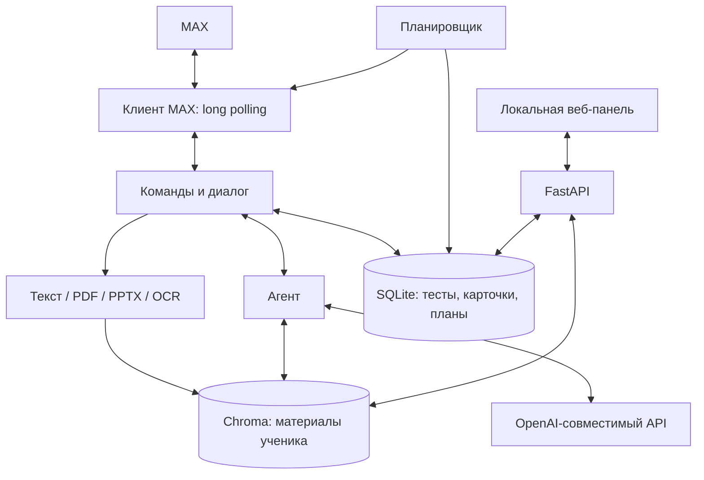

# МаксИИмка

Учебный помощник в MAX. Пришли конспект, презентацию или фотографию страницы —
по этим материалам можно задавать вопросы, готовить тесты и карточки для повторения.
Бот сохраняет результаты занятий, чтобы к ошибкам можно было вернуться позже.

[Открыть бота в MAX](https://max.ru/ideya_fiks_117_bot) ·
[Готовый Docker-образ](#быстрый-запуск-готового-docker-образа) ·
[Свой API-ключ](#свой-api-ключ-и-другая-модель) ·
[Сборка Docker](#сборка-образа-из-исходников) ·
[Простой запуск на Windows](#простой-запуск-на-windows) ·
[Командная строка](#запуск-через-командную-строку) ·
[Пример для проверки](#пример-для-проверки-жюри)

## Что умеет проект

| Задача | Что делает МаксИИмка |
| --- | --- |
| Разобраться в теме | Ищет информацию в материалах ученика и отвечает с указанием страниц |
| Повторить конспект | Готовит краткое содержание выбранного документа |
| Проверить знания | Создаёт тест, проверяет ответы и разбирает ошибки |
| Запомнить определения | Сохраняет карточки для интервального повторения |
| Посмотреть прогресс | Использует историю тестов и повторений |
| Подготовиться к экзамену | Составляет план по дням и присылает напоминания |
| Управлять материалами | Показывает документы и извлечённый текст в веб-панели |
| Настроить модель | Выбирает API, модель, effort, OCR и другие параметры через интерфейс |

Бот работает через long polling: сам получает сообщения из MAX. Для этого
не требуются публичный домен, HTTPS-сервер или туннель. Веб-панель в этой поставке
открывается на компьютере, где запущен бот.

## Что входит в поставку для хакатона

- `Dockerfile` и `compose.yaml` — сборка и запуск Linux-контейнера.
- `requirements.txt` — полный список Python-пакетов с точными версиями;
  зависимости графического окна помечены как Windows-only.
- `requirements-linux.lock.txt` — фактический список установленных пакетов образа,
  включая CPU-сборки PyTorch.
- `release/maxiimka-hackathon-2026-linux-amd64.tar.gz` — экспорт готового Docker-образа.
- `release/SHA256SUMS` — контрольная сумма архива образа.
- Исходники бота, веб-панели и Windows-лаунчера, тесты и примеры документов.
- Настоящие модели поиска и OCR, уже включённые в готовый образ.

**Готовый образ содержит текущие ключи, токен MAX и профиль модели `gpt-4.1-mini`
по запросу автора проекта. Жюри не нужно проходить сетап или вводить ключи.**
Если готовый ключ перестанет работать, можно заменить его своим в панели
по инструкции [ниже](#свой-api-ключ-и-другая-модель). Пересборка образа не требуется.
Вопросы и выбранные фрагменты материалов отправляются настроенному провайдеру LLM.
Для MAX и API модели требуется интернет. Поиск по текстам и локальный OCR работают
на CPU; видеокарта NVIDIA не нужна.

В контейнере отсутствуют `.agents`, `max-api-docs`, документация, тесты,
графический лаунчер, Windows `.venv`, `node_modules` и история Git.
Linux-окружение Python собрано отдельно в `/opt/venv`.

## Быстрый запуск готового Docker-образа

Нужен Docker Engine с Compose либо Docker Desktop в режиме **Linux containers**.
Образ собран для `linux/amd64`. Рекомендуется выделить Docker 4 ГБ оперативной
памяти и оставить минимум 10 ГБ свободного места для образа, распаковки и данных.

Скачай архив образа из **Releases** этого репозитория. В локальном комплекте
он уже находится в папке `artifacts`. Открой терминал в папке проекта.

### 1. Загрузить образ

```sh
docker load --input maxiimka-hackathon-2026-linux-amd64.tar.gz
```

После загрузки доступен образ `maxiimka:hackathon-2026`.

### 2. Запустить бота

```sh
docker run -d --init --name maxiimka --restart unless-stopped -p 127.0.0.1:8000:8000 -v maxiimka-data:/app/data maxiimka:hackathon-2026
```

Либо через Compose:

```sh
docker compose up -d --no-build
```

Сетап и графический лаунчер внутри Docker не запускаются. Контейнер сразу
поднимает HTTP-сервер, подключение к MAX и планировщик.

**С одним токеном MAX должен работать один экземпляр бота.** Перед запуском
контейнера останови ранее запущенную копию в Windows-лаунчере. При удалённой
проверке жюри автор также должен остановить свою копию на время проверки.

### 3. Открыть панель и проверить бота

```sh
docker logs -f maxiimka
```

В журнале появится локальная ссылка вида:

```text
http://127.0.0.1:8000/app/#LocalToken=...
```

Открой **полную ссылку из своего журнала**, включая часть после `#`.
Она даёт доступ к панели администратора на этом компьютере на восемь часов
или до перезапуска контейнера. Токен ссылки создаётся заново при каждом запуске.
Обычный адрес `/app/` без этой части не авторизует администратора.

Проверка HTTP:

```sh
curl http://127.0.0.1:8000/health
```

В PowerShell:

```powershell
Invoke-RestMethod http://127.0.0.1:8000/health
```

Ответ: `{"status":"ok"}`. Это проверка HTTP-сервера; ответы модели и получение
сообщений отдельно проверяются в чате с ботом сценарием ниже.

### Остановка и повторный запуск

```sh
docker stop maxiimka
docker start maxiimka
```

Для запуска через Compose:

```sh
docker compose down
docker compose up -d --no-build
```

Документы, поисковый индекс, настройки, результаты и планы находятся в томе
`maxiimka-data`. Обычная остановка или пересоздание контейнера сохраняет этот том.
Ключи и первоначальные настройки копируются из образа в рабочий профиль только
при первом запуске с пустым томом. Последующие изменения настроек имеют приоритет.

## Свой API-ключ и другая модель

Есть два варианта: использовать готовое подключение из образа или сохранить свой
API-ключ. Ключ провайдера модели меняется через локальную панель даже тогда,
когда прежний ключ недействителен или закончился его лимит.

1. Запусти контейнер и возьми полную ссылку администратора из `docker logs maxiimka`.
2. Открой **Настройки → Подключение**. Для внешнего провайдера выбери
   **OpenAI-совместимый API**.
3. Вставь свой **API-ключ**. Если меняешь провайдера, укажи его **Адрес API**, например
   `https://api.openai.com/v1`. Если ключ и провайдер остаются прежними, поле можно
   вообще не изменять — сохранённый ключ продолжит использоваться.
4. Нажми **Сохранить**. Затем во вкладке **Модель** нажми **Загрузить модели**,
   выбери доступную своему ключу модель в поле «Название модели» и снова сохрани.
5. Вернись в **Подключение** и нажми **Проверить подключение**. Проверка использует
   сохранённые параметры и отправляет короткий запрос выбранной модели.

Новый ключ применяется к следующим запросам бота, включая OCR через модель.
Он сохраняется в Docker-томе `maxiimka-data` и остаётся после перезапуска или
пересоздания контейнера с тем же томом. Сохранённый ключ не возвращается в браузер.

Смена ключа через API панели и сохранение после пересоздания контейнера проверены
отдельно: [key-change-check.json](key-change-check.json). Повторить проверку можно
командой `python scripts/verify-key-change.py`; она использует отдельный временный
том и тестовый ключ, не обращается к модели и не меняет рабочую конфигурацию.

API-ключ модели и токен бота MAX — разные данные. Если нужно заменить именно
токен MAX, укажи свой `MAX_BOT_TOKEN` при запуске нового контейнера. Пример файла
`max-override.env`:

```dotenv
MAX_BOT_TOKEN=your-new-max-bot-token
MAX_ADMIN_ID=your-numeric-max-user-id
```

При запуске через `docker run` добавь `--env-file max-override.env` перед именем
образа. Токен берётся из настроек своего бота в MAX. API-ключ модели
меняется описанным выше способом через панель; сохранённый профиль имеет приоритет
над `LLM_API_KEY` в окружении.

## Сборка образа из исходников

Из корня проекта:

```sh
docker build -t maxiimka:hackathon-2026 .
docker compose up -d --no-build
```

Или одной командой:

```sh
docker compose up -d --build
```

Сборка использует два этапа. На первом Node.js собирает React-интерфейс.
В финальный Python-образ переходят только готовые файлы панели. Затем создаётся
Linux `.venv`, устанавливаются закреплённые зависимости и CPU-версии PyTorch,
добавляются нужные веса моделей и текущая конфигурация из `docker/bundled/`.
`.dockerignore` работает как список разрешённых файлов.

В локальном комплекте `docker/bundled/` уже заполнен, а веса есть в `model-cache/`.
Эти локальные файлы исключены из Git. Для сборки после чистого клонирования:

1. Создай `.env` из `.env.example`, заполни API-ключ и `MAX_ADMIN_ID`.
2. Запиши токен MAX в `max_token.txt` одной строкой.
3. Выполни `python scripts/prepare-config.py` — он подготовит `docker/bundled/`.
4. Выполни `docker build -t maxiimka:hackathon-2026 .`.

Если локального кэша весов нет, они скачиваются во время сборки. Готовому
экспортированному образу повторная установка зависимостей и скачивание весов
для стандартной модели не нужны.

Экспорт своего образа:

```sh
docker save --output maxiimka-hackathon-2026.tar maxiimka:hackathon-2026
```

## Простой запуск на Windows

Нужен **Python 3.14** с tkinter и Python Launcher. Открой `start.cmd` двойным
щелчком либо выполни:

```powershell
.\start.cmd
```

Лаунчер открывает небольшое окно и сам:

1. Создаёт окружение `.venv`.
2. Устанавливает Python-библиотеки.
3. При необходимости подготавливает Node.js и WebView2.
4. Собирает интерфейс и открывает окно запуска.

Первая подготовка занимает несколько минут: устанавливаются PyTorch и другие
библиотеки для поиска и OCR. На строке `Installing collected packages` `pip`
может долго не печатать новых сообщений, пока распаковывает файлы.

В локальном комплекте настройки уже сохранены. В чистой копии откроется мастер:
MAX и ID администратора → провайдер и ключ → модели → effort и OCR → дополнительные
параметры. Модели подтягиваются через API; если `/models` недоступен, имя можно
ввести вручную. Неподтверждённая поддержка изображений не включает Vision.

На экране запуска отметь «Открыть панель» и выбери «Открыть терминал» либо
«Работать в фоне», затем нажми **«Старт»**. В следующий раз откроется тот же экран.
Остановка — кнопка «Остановить»; в терминале также доступна команда `/выход`.

Веса поиска и EasyOCR при обычном запуске Windows загружаются при первом
использовании. В Docker-образ они уже включены.

## Запуск через командную строку

Пример без графического лаунчера, Windows/PowerShell:

```powershell
py -3.14 -m venv .venv
.\.venv\Scripts\python.exe -m pip install -r requirements.txt
```

Если конфигурации ещё нет:

```powershell
Copy-Item .env.example .env
```

Укажи адрес API, ключ и модель в `.env`, токен MAX — в `max_token.txt`.
Пример основных переменных без секретных значений:

```dotenv
MESSENGER=max
UPDATES_MODE=polling
MAX_BOT_ENABLED=1
MAX_TOKEN_FILE=max_token.txt
MAX_ADMIN_ID=123456789
LLM_PROVIDER=openai
LLM_BASE_URL=https://api.openai.com/v1
LLM_API_KEY=your-api-key
LLM_MODEL=gpt-4.1-mini
LLM_MOCK=0
EMBED_MOCK=0
OCR_ENABLED=1
TRANSCRIBE_BACKEND=easyocr
```

Сохранённый профиль `data/settings.json` имеет приоритет над параметрами LLM
из `.env`. Менять существующий профиль удобнее через панель или `/настройки`.

Запустить HTTP-сервер и MAX-бота:

```powershell
.\.venv\Scripts\python.exe main.py
```

Запустить интерактивную консоль и MAX-бота:

```powershell
.\start-terminal.cmd
```

Консоль, MAX и локальная панель одним процессом:

```powershell
.\start-miniapp-local.cmd
```

Последний вариант требует Node.js 20.19+ в PATH. Графический `start.cmd`
подготавливает Node.js самостоятельно, если подходящей версии нет.

Пример загрузки файла в интерактивной консоли:

```text
/файл examples/biology.txt
Где хранится наследственная информация клетки?
Создай тест по этому материалу на 3 вопроса
/выход
```

## Пример для проверки жюри

Тестовый материал: [examples/biology.txt](examples/biology.txt).

1. Запусти **один** экземпляр проекта и открой бота в MAX.
2. Отправь `/start`, затем прикрепи `biology.txt` как файл.
3. Дождись сообщения об окончании обработки материала.
4. Спроси: «Где хранится наследственная информация клетки?».
5. Напиши: «Создай тест по этому материалу на 3 вопроса» и ответь кнопками.
6. Попроси «Объясни мои ошибки», затем «Сделай 5 карточек по теме».
7. Проверь `/файлы`, `/карточки`, `/стата` и документ в локальной панели.

Для проверки OCR можно отправить чёткую фотографию страницы. PDF с текстовым
слоем читается напрямую; сканы и фотографии распознаются выбранным способом.
Первый запрос после запуска может быть медленнее: модель поиска загружается
из диска в память.

## Команды бота

| Команда | Действие |
| --- | --- |
| `/start`, `/меню` | Помощь и кнопки основных действий |
| `/загрузить` | Включить режим приёма конспекта на 10 минут |
| `/файлы` | Список материалов |
| `/конспект [название]` | Краткое содержание |
| `/тест [тема] [на N вопросов]` | Тест; по умолчанию 3 вопроса |
| `/карточки [тема] [на N карточек]` | Карточки для повторения |
| `/повторение` | Карточки, которые пора повторить |
| `/план` | План подготовки к экзамену |
| `/стата` | Результаты занятий |
| `/настройки` | Текущие параметры бота |
| `/id`, `/айди` | Числовой ID пользователя MAX |
| `/удалить <номер или название>` | Удаление одного материала с подтверждением |
| `/очистить` | Очистка учебных данных с подтверждением |
| `/отмена` | Выход из текущего режима |

Можно писать обычными фразами. Тесты и карточки создаются по просьбе ученика;
если подходят несколько документов, бот предложит выбрать один. Количество
вопросов и карточек — от 1 до 20. Повторение использует интервалы 1, 2, 4, 8 и 16 дней.

## Поддерживаемые материалы

| Формат | Обработка |
| --- | --- |
| PDF | Текст и OCR для сканов с сохранением номеров страниц |
| PPTX | До 15 слайдов: текст, таблицы и сохранённые данные диаграмм |
| Фото | EasyOCR на компьютере либо Vision через API |
| TXT | UTF-8, UTF-16 и Windows-1251 |
| ZIP | Фото, PDF, PPTX и TXT объединяются в один материал |
| Длинное сообщение | Сохранение текста как конспекта |

Обычный файл в MAX — до 50 МБ по умолчанию; ZIP — до 150 МБ. В архиве
допускается до 200 файлов, до 300 МБ после распаковки и до 50 МБ на один файл.
При замене документа прежняя версия удаляется только после успешного извлечения
нового текста. Связанные задания после замены создаются заново.

## Как устроен проект



Текст делится на фрагменты по 900 символов с перекрытием 150 символов.
`intfloat/multilingual-e5-small` преобразует фрагменты и вопросы в векторы.
Индекс Chroma разделён по пользователям. Для ответа агент может прочитать
оглавление, краткое содержание, найденные фрагменты и страницы; доступно до 8 шагов.
Оглавления и краткие содержания кэшируются.

Бот и панель используют общие настройки. Администратор может выбрать API и модель,
размер контекста, effort, способ OCR и параллелизм. Уровни effort берутся из
метаданных API или подтверждаются пробой; неизвестные возможности не объявляются
поддерживаемыми.

Извлечённый текст, индекс и учебная история находятся в `data/` либо Docker-томе.
Исходные файлы отдельно не архивируются. Для ответов провайдер LLM получает
вопрос и выбранные фрагменты; при Vision OCR — также изображения.

## Структура исходников

| Путь | Назначение |
| --- | --- |
| `main.py`, `bot/` | Сервер, MAX, команды и сценарии обучения |
| `agent.py`, `llm.py` | Агент и обращения к модели |
| `rag.py`, `pptx_reader.py`, `ocr*.py` | Чтение документов, OCR и поиск |
| `db.py`, `scheduler.py` | SQLite и напоминания |
| `miniapp/`, `webapp/` | API панели и интерфейс React/Stageshow |
| `desktop_launcher/`, `start.cmd` | Установка и запуск на Windows |
| `Dockerfile`, `compose.yaml`, `docker/` | Контейнерная поставка |
| `certs/` | Дополнительные сертификаты для MAX API |
| `requirements.txt` | Закреплённые версии Python-зависимостей |
| `tests/`, `examples/` | Проверки и материал для демонстрации |
| `docs/` | Дополнительные инструкции; в Docker-образ не включаются |

## Проверки

После установки зависимостей:

```powershell
.\.venv\Scripts\python.exe -m unittest discover -s tests -t . -v
.\.venv\Scripts\python.exe -m pip check
```

Автотесты используют временные данные и подменяют внешние API.
Для проверки подготовленного контейнера:

```sh
python scripts/verify-container.py maxiimka:hackathon-2026
```

Проверка запускает отдельный контейнер с выключенным MAX, проверяет HTTP,
локальную авторизацию, настоящую индексацию PDF/TXT, поиск и наличие OCR-весов,
затем удаляет только свой тестовый контейнер. Реальные ключи не выводятся.
Результаты сборки и проверки поставки записаны в `VALIDATION.md`.

Отдельная проверка подключения к MAX и каталогу моделей:

```sh
python scripts/check-services.py maxiimka:hackathon-2026
```

Она читает информацию о боте и список моделей. Сообщения в MAX и запросы генерации
не отправляются; в результате показаны только статусы, значения ключей скрыты.

## Частые вопросы

**Docker пишет, что порт 8000 занят.** Останови другую копию проекта. Для другого
порта используй `-p 127.0.0.1:18080:8000` и замени порт на `18080` в ссылке из журнала,
сохранив `#LocalToken=...`.

**Панель просит локальную ссылку.** Возьми её заново командой `docker logs maxiimka`.
После перезапуска прежняя ссылка больше не действует.

**Бот не отвечает в MAX.** Проверь интернет, журнал контейнера, действительность
токена и отсутствие второй копии с тем же токеном. HTTP `status: ok` сам по себе
не подтверждает доступ к MAX или баланс провайдера модели.

**Docker сообщает `127.0.0.1:10808 ... actively refused` или TLS `UNEXPECTED_EOF`.**
Проверь прокси самого Docker Desktop в Settings → Resources → Proxies. Если
указанный локальный прокси выключен, включи его либо выбери прямое подключение
и примени настройки. Такое ограничение сети не исправляется сменой ключа бота.
Повтори `python scripts/check-services.py` после восстановления подключения.

**В терминале есть предупреждение `HF_TOKEN`.** Для публичной модели поиска
этот токен не обязателен. В Docker необходимые веса уже сохранены локально.

**Изменения в `.env` не меняют модель.** Сохранённый профиль `data/settings.json`
имеет приоритет. Измени настройки в панели. В Docker профиль сохраняется в томе.

**Можно открыть панель прямо внутри MAX?** Для этого нужно отдельно зарегистрировать
мини-приложение с публичным HTTPS-адресом. Эта поставка использует локальную панель;
чат с ботом в MAX работает через long polling.

